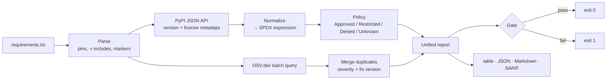

<div align="center">

# 🛡️ SafePyGuard

**Python dependency license & vulnerability scanner — one report, one CI gate.**

[](https://github.com/glichy-gem/SafePyGuard/actions/workflows/ci.yml)


[](https://github.com/glichy-gem/SafePyGuard/blob/main/LICENSE)

</div>

SafePyGuard reads your `requirements.txt` and checks every dependency for two kinds of risk:

| Risk | Example | What SafePyGuard does |
|---|---|---|
| ⚖️ **Legal** | `PyQt5` is GPL-3.0, which can force you to open-source your own code | Classifies each license as **Approved / Restricted / Denied / Unknown** using your policy |
| 🔓 **Security** | `requests==2.19.0` leaks credentials (CVE-2018-18074) | Finds known vulnerabilities via [OSV.dev](https://osv.dev), with severity and the version that fixes them |

Both results land in **one report**, and the **exit code** tells your CI pipeline whether to block the merge.

---

## Contents

- [Demo](#demo)
- [Features](#features)
- [Installation](#installation)
- [Quick start](#quick-start)
- [CLI reference](#cli-reference)
- [Policy file](#policy-file)
- [CI integration](#ci-integration)
- [Python API](#python-api)
- [How it works](#how-it-works)
- [Project structure](#project-structure)
- [Development](#development)
- [License](#license)

---

## Demo

```text
$ safepyguard scan -r examples/requirements-demo.txt

SafePyGuard: examples/requirements-demo.txt
┌──────────┬──────────────────┬──────────────┬────────────┬──────────────────────┐
│ Package  │ Version          │ License      │ Category   │ Vulnerabilities      │
├──────────┼──────────────────┼──────────────┼────────────┼──────────────────────┤
│ requests │ 2.19.0           │ Apache-2.0   │ APPROVED   │ 5 (HIGH) -> 2.33.0   │
│ django   │ 3.2.0            │ BSD-3-Clause │ APPROVED   │ 38 (CRITICAL)        │
│ PyQt5    │ 5.15.0           │ GPL-3.0-only │ DENIED     │ none                 │
│ certifi  │ 2024.8.30        │ MPL-2.0      │ RESTRICTED │ none                 │
│ numpy    │ 2.5.4 (unpinned) │ BSD-3-Clause │ APPROVED   │ none                 │
│ click    │ 8.1.7            │ BSD-3-Clause │ APPROVED   │ none                 │
└──────────┴──────────────────┴──────────────┴────────────┴──────────────────────┘

Vulnerability details
requests 2.19.0
  HIGH      GHSA-x84v-xcm2-53pg (CVE-2018-18074)  fixed in 2.20.0
            Insufficiently Protected Credentials in Requests
  ...

6 package(s) | licenses: 4 approved, 1 restricted, 1 denied | vulnerabilities: 43 (6 critical, 17 high, ...)
FAILED
  - denied license: PyQt5
  - vulnerabilities at or above high severity: requests (1), django (22)
```

---

## Features

**License compliance**
- Normalizes messy license text (`"Apache 2.0"`, `"BSD License"`, `"GPLv3+"`) to standard [SPDX](https://spdx.org/licenses/) IDs
- Reads every place a package can declare a license: PEP 639 `license_expression`, the `license` field, trove classifiers, even a full license text pasted into metadata
- Understands SPDX expressions — `MIT OR Apache-2.0`, `(MIT AND BSD-3-Clause)`, `WITH` exceptions
- Configurable TOML policy with wildcards (`GPL-*`) and per-package exceptions with a recorded reason

**Vulnerability scanning**
- Queries [OSV.dev](https://osv.dev) in one batch request (no API key needed)
- Merges duplicate advisories (GHSA / PYSEC / CVE) into a single finding
- Severity from GitHub advisories, falling back to a built-in CVSS v3.1 calculator
- Shows the smallest version that fixes each issue

**Built for CI**
- Exit codes: `0` passed · `1` policy violated · `2` scan could not run
- Output as a terminal table, **JSON**, **Markdown** (PR comments) or **SARIF** (GitHub Security tab)
- Ready-made **GitHub Action** and **pre-commit** hook
- Concurrent lookups and a 24-hour on-disk cache for fast repeat runs

---

## Installation

Requires **Python 3.10+**.

```bash
pip install safepyguard
```

<details>
<summary>Install from a local clone (for development)</summary>

```bash
git clone https://github.com/glichy-gem/SafePyGuard.git
cd SafePyGuard
python -m venv .venv
source .venv/bin/activate          # Windows: .venv\Scripts\activate
pip install -e ".[dev]"
```
</details>

---

## Quick start

```bash
# 1. Scan your project's requirements
safepyguard scan -r requirements.txt

# 2. (Optional) create an editable policy file in the current directory
safepyguard init-policy

# 3. Scan again — safepyguard.toml is picked up automatically
safepyguard scan
```

Try it on the bundled demo file:

```bash
safepyguard scan -r examples/requirements-demo.txt
```

---

## CLI reference

```text
safepyguard scan [OPTIONS]
```

| Option | Description | Default |
|---|---|---|
| `-r, --requirements PATH` | Requirements file to scan | `requirements.txt` |
| `-p, --policy PATH` | Policy TOML file | `./safepyguard.toml` if present, else built-in |
| `-f, --format` | `table`, `json`, `markdown`, `sarif` | `table` |
| `-o, --output PATH` | Write the report to a file | terminal |
| `--fail-on-license` | Categories that fail the scan, e.g. `denied,unknown`, or `none` | from policy (`denied`) |
| `--fail-on-severity` | `low`, `moderate`, `high`, `critical`, `none` | from policy (`high`) |
| `--ignore-vuln ID` | Ignore a vulnerability ID or alias (repeatable) | — |
| `--no-licenses` | Skip the license check | — |
| `--no-vulns` | Skip the vulnerability check | — |
| `--no-cache` | Don't use the on-disk cache | — |
| `--timeout SECONDS` | Network timeout | `15` |

Other commands: `safepyguard init-policy [--path FILE] [--force]` · `safepyguard --version`

**Exit codes**

| Code | Meaning |
|---|---|
| `0` | Every dependency passed the policy |
| `1` | The policy was violated (CI should fail) |
| `2` | The scan could not run (missing file, invalid policy, network down) |

> **Unpinned requirements** such as `numpy>=1.26` are checked against the newest matching release (pre-releases and yanked releases are skipped). Pin your dependencies for reproducible results.

---

## Policy file

Generate one with `safepyguard init-policy`, then edit it:

```toml
[licenses]
approved   = ["MIT", "BSD-3-Clause", "Apache-2.0", "ISC", "PSF-2.0"]
restricted = ["LGPL-*", "MPL-*"]      # allowed, but needs a review
denied     = ["GPL-*", "AGPL-*"]      # wildcards are supported

[exceptions]                          # per-package overrides, with a reason for auditors
"pyqt5" = { category = "approved", reason = "Commercial license purchased, LEGAL-123" }

[vulnerabilities]
ignore = ["GHSA-xxxx-xxxx-xxxx"]      # accepted risks (IDs or CVE aliases)

[gate]
fail_on_license  = ["denied"]         # approved | restricted | denied | unknown
fail_on_severity = "high"             # low | moderate | high | critical | none
```

**Classification rules**

| Situation | Result | Why |
|---|---|---|
| `MIT OR GPL-3.0-only` | Approved | With `OR` you may *choose*, so the most permissive option wins |
| `MIT AND GPL-3.0-only` | Denied | With `AND` you must comply with *both*, so the strictest wins |
| Exact entry vs. wildcard | Exact wins | `approved = ["GPL-2.0-only"]` overrides `denied = ["GPL-*"]` |
| Same precision in two lists | Stricter wins | denied > restricted > approved |
| License not in any list / unrecognized | Unknown | Add `"unknown"` to `fail_on_license` to require a review |
| Vulnerability with unknown severity | Fails the gate | If severity can't be determined, a human should look |

See [`examples/policy-strict.toml`](https://github.com/glichy-gem/SafePyGuard/blob/main/examples/policy-strict.toml) for a production-style policy.

---

## CI integration

### GitHub Actions

```yaml
- uses: actions/checkout@v4
- uses: glichy-gem/SafePyGuard@v0.1.0
  with:
    requirements: requirements.txt
    fail-on-severity: high
```

To show findings in the repository's **Security** tab, export SARIF and upload it — see the complete workflow in [`examples/github-workflow.yml`](https://github.com/glichy-gem/SafePyGuard/blob/main/examples/github-workflow.yml).

| Action input | Default |
|---|---|
| `requirements` | `requirements.txt` |
| `policy` | auto-detect |
| `format` | `table` |
| `output` | — |
| `fail-on-license` | from policy |
| `fail-on-severity` | from policy |
| `python-version` | `3.12` |

### pre-commit

```yaml
repos:
  - repo: https://github.com/glichy-gem/SafePyGuard
    rev: v0.1.0
    hooks:
      - id: safepyguard
```

### Any other CI (GitLab, Jenkins, Azure DevOps…)

```bash
pip install safepyguard
safepyguard scan -r requirements.txt -f markdown -o safepyguard-report.md
```

The non-zero exit code fails the job on its own.

---

## Python API

```python
from safepyguard import evaluate, scan

report = scan("requirements.txt", policy="safepyguard.toml")
gate = evaluate(report)

for package in report.packages:
    print(package.name, package.version, package.license.category.value)
    for vuln in package.vulnerabilities:
        print(f"  {vuln.severity.label:<9} {vuln.id}  fix: {vuln.fix_version}")

print("PASSED" if gate.passed else gate.reasons)
```

---

## How it works



---

## Project structure

```text
SafePyGuard/
├── src/safepyguard/            # the installable package
│   ├── cli.py                  #   command-line interface (click)
│   ├── scanner.py              #   orchestrates the whole scan
│   ├── gate.py                 #   pass/fail decision and exit codes
│   ├── models.py               #   data classes: Dependency, Vulnerability, Report…
│   ├── cache.py                #   24-hour on-disk JSON cache
│   ├── errors.py               #   exception hierarchy
│   ├── parsers/
│   │   └── requirements.py     #   requirements.txt → dependencies
│   ├── sources/
│   │   ├── pypi.py             #   PyPI JSON API client
│   │   ├── osv.py              #   OSV.dev client, de-duplication, CVSS scoring
│   │   └── http.py             #   shared HTTP client settings
│   ├── licenses/
│   │   ├── normalize.py        #   license text → SPDX expression
│   │   ├── policy.py           #   TOML policy loading and classification
│   │   └── default_policy.toml #   built-in policy
│   └── reporters/              #   table, JSON, Markdown and SARIF output
├── tests/
│   ├── unit/                   # one test file per module, fully offline
│   ├── integration/            # end-to-end scanner and CLI tests (+ one live test)
│   ├── fakes.py                # in-memory fake PyPI and OSV servers
│   └── conftest.py             # shared fixtures
├── examples/                   # demo requirements, strict policy, CI workflow
├── .github/workflows/          # CI (lint, type-check, tests) and PyPI release
├── action.yml                  # the reusable GitHub Action
├── .pre-commit-hooks.yaml      # the reusable pre-commit hook
├── pyproject.toml              # packaging + tool configuration
├── CHANGELOG.md
└── LICENSE
```

---

## Development

```bash
pip install -e ".[dev]"

pytest                      # 159 offline tests against fake PyPI/OSV servers
pytest -m network           # live test against the real APIs
ruff check . && ruff format --check .
mypy                        # strict type checking
```

CI runs the test suite on Python 3.10–3.13 on both Ubuntu and Windows.

**Releasing:** bump `src/safepyguard/_version.py`, update `CHANGELOG.md`, then push a tag such as `v0.1.0`. The release workflow builds the package and publishes it to PyPI via trusted publishing.

---

## License

[MIT](https://github.com/glichy-gem/SafePyGuard/blob/main/LICENSE) © 2026 Shivam Yadav
